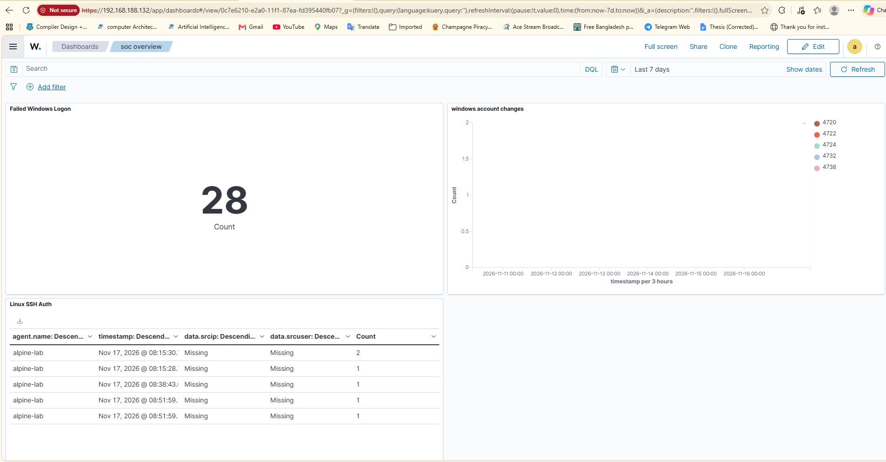
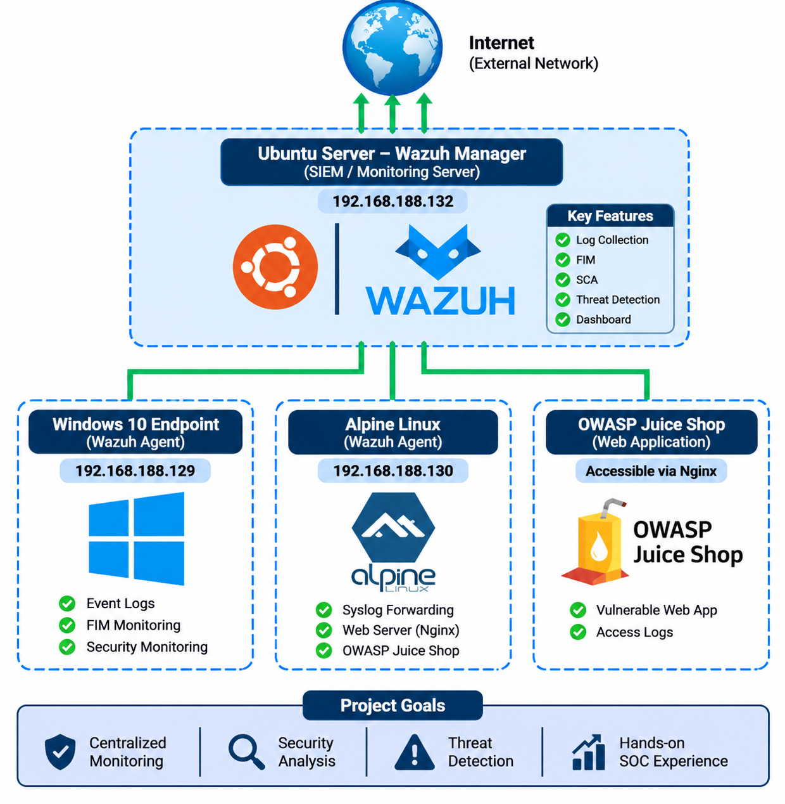
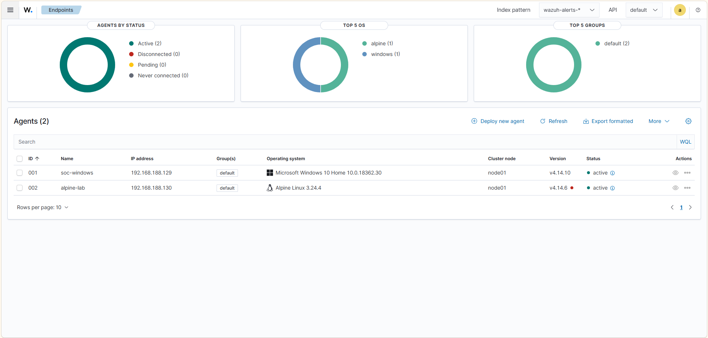
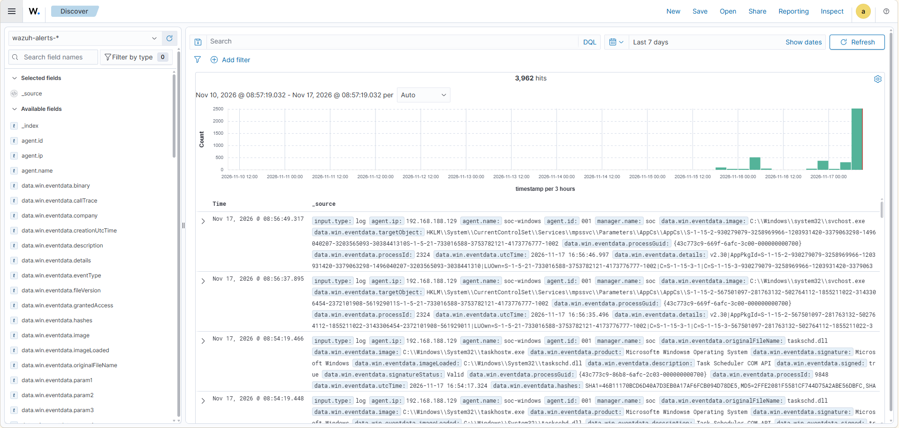
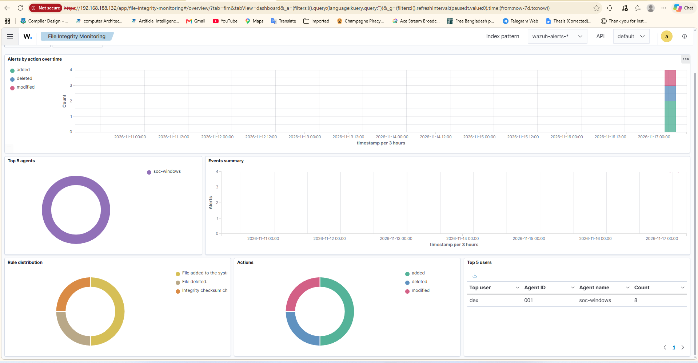
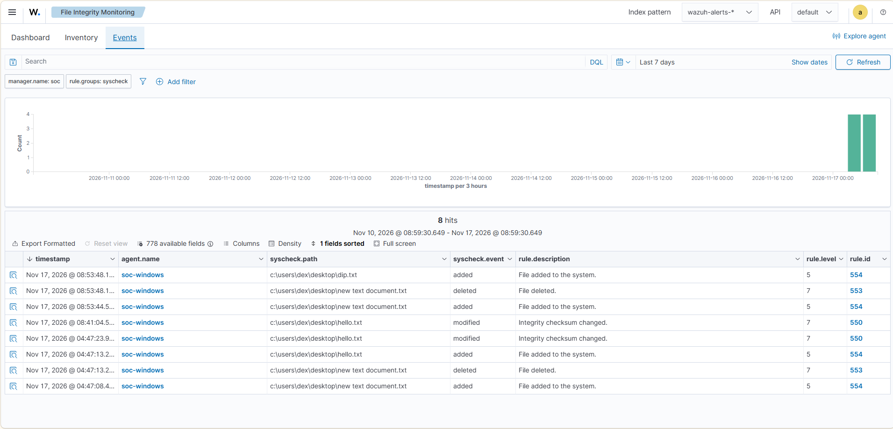
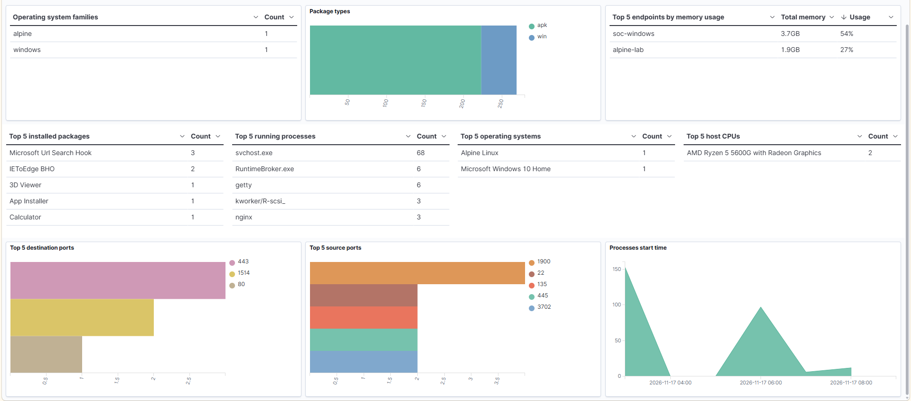
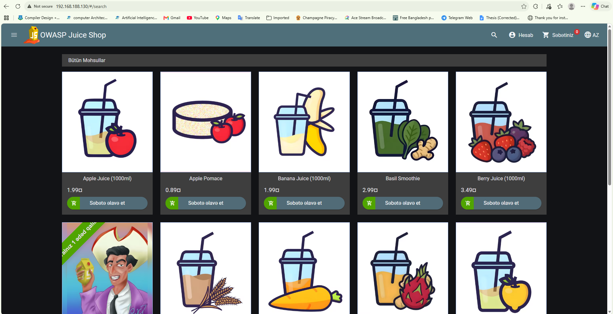

# Multi-Platform SOC Monitoring Lab

**Wazuh SIEM · Windows & Linux Endpoint Monitoring · FIM · SCA · MITRE ATT&CK · Web Logging**

Personal cybersecurity project | 2026

---

A small, multi-platform Security Operations Center (SOC) lab built to practise centralized log collection, endpoint monitoring, threat detection, and alert investigation. A **Wazuh Manager** on Ubuntu Server collects telemetry from a **Windows 10** workstation and an **Alpine Linux** server, while **Nginx** fronts an **OWASP Juice Shop** instance to generate realistic web traffic and access logs.

This repository contains the architecture diagram, configuration examples, step-by-step build documentation, screenshots taken from the lab, and a written investigation of a File Integrity Monitoring (FIM) alert.

## Highlights

| | |
|:--|:--|
| **2 active endpoints** | Windows 10 (`soc-windows`) and Alpine Linux (`alpine-lab`) reporting to one manager |
| **~3,962 alerts** in a 7-day window in `wazuh-alerts-*` | Real endpoint telemetry, not synthetic demo data |
| **FIM validated end-to-end** | Added / modified / deleted file events captured in the Wazuh dashboard |
| **CIS SCA executed** | `cis_win10_enterprise.yml` policy loaded and evaluated on Windows |
| **Sysmon telemetry ingested** | Process creation, image loads, registry activity and file hashes visible in Discover |
| **MITRE ATT&CK coverage** | Techniques mapped across both endpoints in the ATT&CK dashboard |
| **Vulnerability detection** | CVEs correlated to installed Windows packages and OS build |
| **Intentional vulnerable app** | OWASP Juice Shop served over Nginx behind an isolated lab network |



## Architecture

The diagram below shows the logical layout of the lab. All machines were hosted in VMware Workstation on an isolated host-only/bridged lab segment.



| Host / role | Address | Function |
|:--|:--|:--|
| Ubuntu Server — Wazuh Manager | `192.168.188.132` | Log collection, rule engine, alerts, dashboard, SCA and vulnerability correlation |
| Windows 10 — `soc-windows` | `192.168.188.129` | Wazuh Agent v4.14.10, Windows event logs, Sysmon, FIM, CIS SCA |
| Alpine Linux — `alpine-lab` | `192.168.188.130` | Wazuh Agent, Nginx reverse proxy, OWASP Juice Shop, syslog source |
| VMware Workstation | Host | Virtualization, networking, snapshots |

Agent inventory after the build:



## What was implemented

### 1. Central Wazuh manager
Deployed the Wazuh manager and dashboard on Ubuntu Server, confirmed agent-to-manager connectivity on TCP/1514, and used the Wazuh web interface (`https://192.168.188.132`) for monitoring, searching and reporting. Build notes: [documentation/wazuh-installation.md](documentation/wazuh-installation.md).

### 2. Windows endpoint monitoring
Installed and registered the Windows agent, verified the `WazuhSvc` service state and startup logs, and confirmed collection of the **Application**, **Security** and **System** event channels. Windows account-management events (4720, 4722, 4724, 4732, 4738) are visible on the custom SOC overview dashboard. Sysmon was installed with a configuration file and Sysmon fields (`data.win.eventdata.*`) are searchable in Discover. Build notes: [documentation/windows-agent-setup.md](documentation/windows-agent-setup.md).



### 3. File Integrity Monitoring (FIM)
Monitored the user Desktop and the Windows Startup folder in real time. A harmless test file generated **8 `syscheck` alerts** in the dashboard — `added` (rule 554), `modified` / integrity checksum changed (rule 550), and `deleted` (rule 553). Configuration: [configurations/windows-fim-config.xml](configurations/windows-fim-config.xml). Setup: [documentation/fim-configuration.md](documentation/fim-configuration.md). Investigation: [investigation/fim-investigation.md](investigation/fim-investigation.md).





### 4. Security Configuration Assessment (SCA)
The Windows agent loaded the CIS Windows 10 Enterprise policy (`cis_win10_enterprise.yml`) and completed the assessment scan. Sysmon/Windows inventory data also populates the *System Inventory / IT Hygiene* view, showing installed packages, running processes, CPUs and listening/destination ports.



### 5. Alpine Linux, Nginx and OWASP Juice Shop
Built a lightweight Alpine Linux VM, resolved APK repository and OpenRC service issues, and deployed OWASP Juice Shop behind Nginx. The application was reachable over HTTP on the lab network, with Nginx access and error logs available for forwarding. Build notes: [documentation/alpine-agent-setup.md](documentation/alpine-agent-setup.md) and [documentation/nginx-juice-shop.md](documentation/nginx-juice-shop.md).



### 6. Detection and analysis views
Used the stock Wazuh dashboards for security analysis rather than only collecting logs:

| View | What it demonstrated | Screenshot |
|:--|:--|:--|
| Threat Hunting | Alert-level evolution, high-severity alerts, authentication success/failure, top MITRE techniques | [threat-hunting-dashboard.png](screenshots/threat-hunting-dashboard.png) |
| MITRE ATT&CK | Tactics and techniques mapped per agent — Process Injection, LSASS Memory, Lateral Tool Transfer, PowerShell, Ingress Tool Transfer, Valid Accounts, Sudo and Sudo Cache, Remote Services, Create Account | [mitre-attack-framework.png](screenshots/mitre-attack-framework.png) |
| Vulnerability Detection | CVEs by severity and affected package, e.g. CVE-2024-43590 on the Windows 10 build, CVE-2021-43208 / CVE-2021-43209 on installed apps | [vulnerability-detection.png](screenshots/vulnerability-detection.png) |
| Linux SSH Auth | "Failed password" events from `alpine-lab` searched in `wazuh-archives-*` | [linux-ssh-auth.png](screenshots/linux-ssh-auth.png) |

### 7. Syslog forwarding
Linux system and Nginx logs were configured as Wazuh log sources using `<localfile>` entries. The template used for these sources is in [configurations/syslog-config.txt](configurations/syslog-config.txt).

## Validation summary

| Capability | Status | Evidence |
|:--|:--|:--|
| Manager reachable, agents active | Confirmed | `windows-agents-connected.png` — 2 active, 0 disconnected, 0 pending |
| Windows agent connected to manager | Confirmed | Agent log `(4102): Connected to the server [192.168.188.132]:1514/tcp`; `v4.14.10` |
| Windows event log collection | Confirmed | Application / Security / System channels in agent log and dashboard |
| Sysmon event ingestion | Confirmed | `data.win.eventdata.*` fields in `wazuh-discover-events.png` |
| FIM alert detected in dashboard | Confirmed | `fim-alert-events.png` — 8 syscheck events, rules 550 / 553 / 554 |
| CIS SCA scan executed | Confirmed | Agent log: policy loaded, evaluation finished in 28 s |
| SCA compliance score captured | **Not captured** | Add a screenshot of the SCA policy results page |
| Nginx reverse proxy serving Juice Shop | Confirmed | `alpine-juice-shop.png` — application reachable over HTTP |
| Nginx `/var/log` files ingested as Wazuh alerts | **Not confirmed** | Logs generated locally; manager-side alert evidence still to be captured |
| Syslog end-to-end alert in Wazuh | Partial | "Failed password" events visible in archives; source IP/user fields not extracted |
| VMware VM layout | Confirmed | `vmware-lab-environment.png` |

Items marked *not captured* or *not confirmed* are intentionally left honest — they are the next things to add if this repo is used for a job application.

## Troubleshooting solved

- **Windows agent service would not restart** — rechecked with `sc.exe queryex WazuhSvc`, confirmed STOPPED/PID 0, restarted with `Start-Service`, then verified the new PID and connection in `ossec.log`.
- **Invalid FIM XML** — `report_changes=""yes"` corrected to `report_changes="yes"` and directory entries placed inside `<syscheck>`.
- **Alpine `apk` could not find packages** — repositories pointed at `/media/cdrom/apk`; inspected `/etc/apk/repositories` and switched to reachable mirrors.
- **Nginx `emerg invalid url prefix`** — `proxy_pass 127.0.0.1:3000;` corrected to `proxy_pass http://127.0.0.1:3000;` and validated with `nginx -t`.
- **VMware clipboard / networking** — checked guest integration settings and virtual network adapters until the lab hosts could reach each other.

## Repository structure

```text
multi-platform-soc-monitoring-lab/
├── README.md
├── architecture/
│   └── soc-lab-architecture.png
├── screenshots/
│   ├── README.md
│   ├── wazuh-dashboard.png
│   ├── wazuh-discover-events.png
│   ├── windows-agents-connected.png
│   ├── fim-alerts-overview.png
│   ├── fim-alert-events.png
│   ├── system-inventory-hygiene.png
│   ├── linux-ssh-auth.png
│   ├── mitre-attack-framework.png
│   ├── threat-hunting-dashboard.png
│   ├── vulnerability-detection.png
│   ├── alpine-juice-shop.png
│   └── vmware-lab-environment.png
├── configurations/
│   ├── README.md
│   ├── windows-fim-config.xml
│   ├── nginx-config.conf
│   └── syslog-config.txt
├── documentation/
│   ├── wazuh-installation.md
│   ├── windows-agent-setup.md
│   ├── alpine-agent-setup.md
│   ├── fim-configuration.md
│   └── nginx-juice-shop.md
└── investigation/
    └── fim-investigation.md
```

## Documentation index

- [Wazuh manager installation](documentation/wazuh-installation.md)
- [Windows agent setup](documentation/windows-agent-setup.md)
- [Alpine Linux agent setup](documentation/alpine-agent-setup.md)
- [FIM configuration and validation](documentation/fim-configuration.md)
- [Nginx and OWASP Juice Shop](documentation/nginx-juice-shop.md)
- [FIM alert investigation](investigation/fim-investigation.md)

## Skills demonstrated

Centralized SIEM deployment · Windows and Linux agent management · Windows Event Log and Sysmon telemetry · File Integrity Monitoring · CIS Security Configuration Assessment · Nginx reverse proxying · syslog forwarding · MITRE ATT&CK mapping · vulnerability management · alert triage and incident documentation · VMware virtual networking · technical reporting.

## Safety and privacy

OWASP Juice Shop was run **only** inside an isolated, authorized lab network and was never exposed to the public internet. Test files were harmless and removed after evidence collection. IP addresses, hostnames and usernames in this repository describe lab-only systems. No passwords, enrollment keys or private credentials are included; configuration files are sanitized examples. Review screenshots before publishing if your own lab uses different addresses.

---

